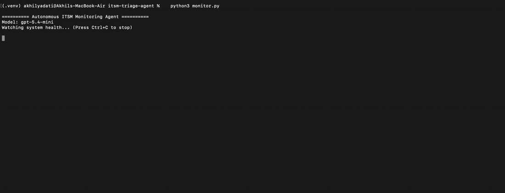

# ITSM Incident Triage Agent

An AI-powered ITSM agent that detects system issues, generates incidents, and triages them on its own, with human review reserved for high-priority incidents. Built to demonstrate how LLM-based reasoning can fill a real gap in enterprise ITSM tooling.

<!-- Demo: add a GIF of monitor.py + stress.py here, e.g.  -->

## The Problem

ServiceNow's built-in AI (Predictive Intelligence) requires historical incident data to triage effectively. New ServiceNow implementations have zero historical tickets, so the AI doesn't work well on day one — it needs months of accumulated data first.

This project explores an alternative: using a pre-trained LLM that requires zero training data and works immediately. The agent detects problems on its own and triages them in real time.

## How It Works

The system has two layers:

1. **Autonomous Detection (monitor.py)**
Continuously watches real system health metrics (CPU, memory, disk) on the host machine. When a threshold is breached, it automatically generates an incident — no human files a ticket. A cooldown prevents duplicate incidents while the same condition stays breached, so one sustained spike produces one ticket, not an alert storm.

2. **AI Triage (triage.py, shared by both entry points)**
Uses an OpenAI model to analyze the incident and reason through:
- Category (Infrastructure, Access Management, Network, Collaboration Tools, Application Support, General IT)
- Priority (P1–P4)
- SLA target
- Assignment group
- A plain-English reason for its decision

3. **Human-in-the-loop for high priority**
P3/P4 incidents are auto-assigned. P1/P2 incidents are flagged `pending_review` so a person confirms the call before anything critical is routed. Automation handles the volume; people keep control of the decisions that matter most.

Every detected incident is logged to `incidents_log.json` with its timestamp, model, triage result, and status, for an auditable history.

## Why Real System Metrics, Not Simulated Logs

I considered using my ServiceNow PDI for incident data, but PDIs only contain sample/demo data, not real operational signals. Instead, I used my own machine's live CPU, memory, and disk metrics via Python's psutil library — real, changing data, not a script printing fake logs. In production, this same architecture would point at a real server's metrics instead of a personal laptop.

## How To Run

Setup:
```bash
pip install -r requirements.txt
export OPENAI_API_KEY="your-key-here"
# optional: choose a different model (default: gpt-5.4-mini)
export OPENAI_MODEL="gpt-5.4-mini"
```

Manual triage (human-reported incident):
```bash
python3 triage.py
```

Autonomous monitoring:
```bash
python3 monitor.py
```

To trigger a live demo anomaly (in a second terminal):
```bash
python3 stress.py
```

## Sample Autonomous Output

```
[15:30:23] CPU: 99.9% | Memory: 76.5% | Disk: 20.7%

🚨 ANOMALY DETECTED: High CPU usage detected: 99.9%
Auto-generating incident and triaging with AI...

--- AI Triage Result ---
CATEGORY: Infrastructure
PRIORITY: P1 - Critical
SLA: 1 hour
ASSIGNMENT GROUP: Infrastructure Team
REASON: High CPU usage at 99.9% indicates a critical system performance issue that requires immediate attention to prevent system failure or downtime.

STATUS: Pending human review (high priority)
============================================================
Incident logged to incidents_log.json
```

## Tech Stack
- Python 3.12
- OpenAI API (model configurable via `OPENAI_MODEL`)
- psutil (system metrics)

## Architecture Notes
- API keys and model choice are loaded from environment variables, never hardcoded — matching standard secrets-management practice in production systems.
- Triage logic lives in one module shared by the manual and autonomous entry points.

## Author
Akhil Yadati — ServiceNow Developer | ITSM Specialist
